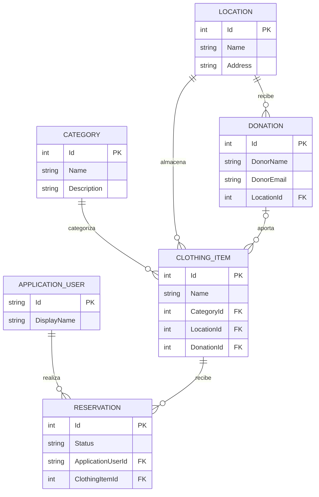

# 1 Presentacion de CorporaDress

## Presentación

**CorporaDress** nace como una iniciativa solidaria para ayudar a las personas que necesitan vestimenta adecuada para afrontar entrevistas de trabajo y otras situaciones profesionales.

Desde el **Grupo Adecco**, contamos con un amplio ropero solidario a disposición de quienes puedan necesitarlo. CorporaDress facilita la gestión de este servicio, centralizando toda la logística necesaria: desde el registro y la clasificación de las prendas disponibles hasta el seguimiento actualizado de las donaciones, el inventario y las reservas.

Nuestro objetivo es ofrecer una aplicación **útil, intuitiva y accesible**, que permita tanto a los administradores como a los usuarios.

En definitiva, CorporaDress busca convertir la gestión de un recurso solidario en un proceso sencillo, organizado y accesible para todos.

# 2 Funcionalidades principales

- Catálogo de prendas (trajes, americanas, vestidos, camisas, zapatos, etc.) con fotos, tallas y disponibilidad.
 -   Búsqueda y filtros por categoría, talla y tipo de prenda.
-    Registro e inicio de sesión de usuarios.
-    Reserva de una o varias prendas para una entrevista de trabajo.
-    Gestión de préstamos y devoluciones, con fechas previstas.
-    Historial de reservas y préstamos de cada usuario.
-    Gestión del inventario: añadir, editar y retirar prendas donadas.
- Panel de administración para gestionar usuarios, reservas y préstamos.

## Diagrama de entidades

pequeño cambio jiji