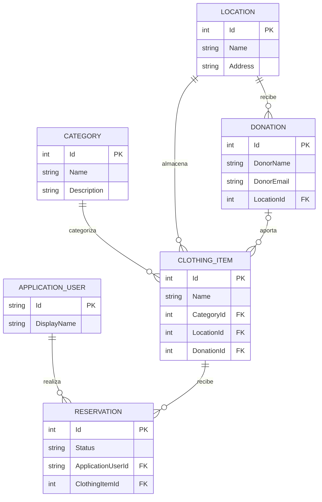

# 1 Presentacion de CorporaDress

**CorporaDress** nace como una iniciativa solidaria para ayudar a las personas que necesitan vestimenta adecuada para afrontar entrevistas de trabajo y otras situaciones profesionales.

Desde el **Grupo Adecco**, contamos con un amplio ropero solidario a disposición de quienes puedan necesitarlo. CorporaDress facilita la gestión de este servicio, centralizando toda la logística necesaria: desde el registro y la clasificación de las prendas disponibles hasta el seguimiento actualizado de las donaciones, el inventario y las reservas.

Nuestro objetivo es ofrecer una aplicación **útil, intuitiva y accesible**, que permita tanto a los administradores como a los usuarios.

En definitiva, CorporaDress busca convertir la gestión de un recurso solidario en un proceso sencillo, organizado y accesible para todos.

# 2 Funcionalidades principales

- Llevar un catálogo de prendas con fotos, tallas y disponibilidad.
- Gestión del inventario: añadir, editar y retirar prendas donadas.
- Panel de administración para gestionar usuarios, reservas y préstamos.
- Búsqueda y filtros por categoría, talla y tipo de prenda.
- Registro e inicio de sesión de usuarios.
- Reserva de una o varias prendas para una entrevista de trabajo.
- Gestión de préstamos y devoluciones, con fechas previstas.
- Historial de reservas y préstamos de cada usuario.

# 3 Entidades asignadas


| Entidad        | Realizada por | Controlador               | Realizado por | Vista                 | Realizado por |
| -------------- | ------------- | ------------------------- | ------------- | --------------------- | ------------- |
| `Category`     | Jordi         | `CategoriesController`    | Cesar         | `Views/Categories`    | Cesar         |
| `Location`     | Cesar         | `LocationController`      | Cesar         | `Views/Location`      | Cesa          |
| `ClothingItem` | Jordi         | `ClothingItemsController` | Jordi         | `Views/ClothingItems` | Jordi         |
| `Reservation`  | Joel          | `ReservationsController`  | Joel          | `Views/Reservations`  | Joel          |
| `Donation`     | Toni          | `DonationController`      | Toni          | `Views/Donation`      | Toni          |


| Entidad                 | Controlador                        | Vistas                         |
| ----------------------- | ---------------------------------- | ------------------------------ |
| `Category` · Jordi     | `CategoriesController` · Cesar    | `Views/Categories` · Cesar    |
| `Location` · Cesar     | `LocationController` · Cesar      | `Views/Location` Cesar         |
| `ClothingItem` · Jordi | `ClothingItemsController` · Jordi | `Views/ClothingItems` · Jordi |
| `Reservation` · Joel   | `ReservationsController` · Joel   | `Views/Reservations` · Joel   |
| `Donation` · Toni      | `DonationController` · Toni       | `Views/Donation` · Toni       |


| Compañero | Entidad                        | Controlador                                        | Vista                                   |
| ---------- | ------------------------------ | -------------------------------------------------- | --------------------------------------- |
| Jordi      | `Category` · `ClothingItem` | `ClothingItemsController`                          | `Views/ClothingItems`                   |
| Cesar      | `Location`                     | `CategoriesController` · `LocationController`  | `Views/Categories` · `Views/Location` |
| Joel       | `Reservation`                  | `ReservationsController`                           | `Views/Reservations`                    |
| Toni       | `Donation`                     | `DonationController`                               | `Views/Donation`                        |

## 4 Diagrama de entidades


## 5 Imagenes de la aplicación


## 6 Instalación inicial

Instala .NET 10 SDK, Visual Studio Code y C# Dev Kit una sola vez en el ordenador.

### Windows (PowerShell)

```powershell
winget install --id Microsoft.DotNet.SDK.10 --exact
winget install --id Microsoft.VisualStudioCode --exact
winget install --id Git.Git --exact
```

Cierra y abre una terminal nueva; después instala la extensión:

```powershell
code --install-extension ms-dotnettools.csdevkit
```

### macOS (Terminal, con Homebrew)

```bash
brew install dotnet
brew install --cask visual-studio-code
brew install git
code --install-extension ms-dotnettools.csdevkit
```

Si no utilizas Homebrew, instala el SDK de .NET 10 con el instalador oficial de
[macOS](https://dotnet.microsoft.com/download/dotnet/10.0) y añade C# Dev Kit desde
el panel Extensions de VS Code.

### Ubuntu 26.04 (Terminal)

```bash
sudo apt-get update
sudo apt-get install -y dotnet-sdk-10.0 git
sudo snap install code --classic
code --install-extension ms-dotnettools.csdevkit
```

Para otra distribución Linux, sigue el instalador oficial de
[.NET para Linux](https://learn.microsoft.com/dotnet/core/install/linux) y, una vez
instalado VS Code, ejecuta el último comando.

Comprueba la instalación desde esta carpeta:

```bash
dotnet --version
```

Debe mostrar una versión que empiece por `10.0`.
Si el comando `code` no se reconoce, abre VS Code e instala C# Dev Kit desde
**Extensions**.

## Primer arranque

Clona el repositorio y abre **su carpeta** (no una carpeta superior) en VS Code. C# Dev Kit carga automáticamente `G1AspNet.sln`.

```bash
git clone https://github.com/certidevs/g1_aspnet.git
cd g1_aspnet
code .
dotnet restore G1AspNet.sln
dotnet tool restore
dotnet run --project G1AspNet.csproj --launch-profile http
```

Abre `http://localhost:5107`. El primer arranque crea `App_Data/g1.db`, crea las tablas y añade los usuarios demo:

- `admin` / `Admin123!`
- `user` / `User123!`

## 6 Que hemos aprendido